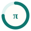

# Seat icons

The marks the debate desk, saved reports and PDFs use for each seat. They are free to reuse in
any argue tool or fork (MIT, like the rest of this repo).

These are simple generic marks in each family's well-known colors, **not official logos**; the
product names and their trademarks belong to their owners.

How a seat gets its icon: the **model id** is matched first (so an Antigravity seat running
`claude-opus-*` shows the Claude mark), then the **CLI** it runs, then a neutral fallback.
To add a family, add an entry to `packages/argue-cli/src/ui/themes.ts` and run:

```bash
npm run build -w packages/argue-cli && node scripts/export-seat-icons.mjs
```

| Icon                                                   | Family             | Color                                                              | Mark       | Model ids matched | CLIs                    |
| ------------------------------------------------------ | ------------------ | ------------------------------------------------------------------ | ---------- | ----------------- | ----------------------- | ----------------------- | -------- | --------- | --------- | -------- | ------ |
|    | **Claude**         | `#D97757`                                                          | ✻          | `claude           | opus                    | sonnet                  | haiku    | fable`    | `claude`  |
|   | **ChatGPT**        | `#1f1f1f`                                                          | drawn knot | `^gpt             | ^o[1-9]                 | codex                   | chatgpt` | `codex`   |
|    | **Gemini**         | `#7b6fd8` (gradient `#4285F4` → `#9B72CB` → `#D96570`)             | ✦          | `gemini           | gemma`                  | `antigravity`, `gemini` |
|      | **Meta Llama**     | `#0866FF`                                                          | ∞          | `llama            | meta`                   | —                       |
|   | **Mistral**        | `#FA520F` (gradient `#FFD800` → `#FF8205` → `#FA500F` → `#E10500`) | ▚          | `mistral          | mixtral                 | codestral               | devstral | magistral | ministral | pixtral` | `vibe` |
|      | **Qwen**           | `#615CED`                                                          | ◈          | `qwen             | qwq`                    | `qwen`                  |
|  | **DeepSeek**       | `#4D6BFE`                                                          | ◗          | `deepseek`        | —                       |
|      | **Grok**           | `#2b2b2b`                                                          | ⨯          | `grok`            | —                       |
|      | **Kimi**           | `#1f2937`                                                          | ☾          | `kimi             | moonshot`               | `kimi`                  |
|   | **GitHub Copilot** | `#8250DF`                                                          | ◉          | —                 | `copilot`               |
|    | **Cursor**         | `#2d2d2d`                                                          | ⬢          | —                 | `cursor-agent`, `agent` |
|    | **Ollama**         | `#3a3a3a`                                                          | ◔          | —                 | `ollama`                |
|     | **Goose**          | `#2f3b4a`                                                          | ◒          | —                 | `goose`                 |
|     | **Aider**          | `#14A33C`                                                          | ✎          | —                 | `aider`                 |
|       | **llm**            | `#5b6573`                                                          | ›          | —                 | `llm`                   |
|  | **opencode**       | `#3b3b3b`                                                          | ▣          | —                 | `opencode`              |
|       | **Amp**            | `#E5484D`                                                          | ϟ          | —                 | `amp`                   |
|     | **Factory droid**  | `#e05d2a`                                                          | ◇          | —                 | `droid`                 |
|        | **pi**             | `#0f766e`                                                          | π          | —                 | `pi`                    |

`palette.json` has the same data for other tools.
